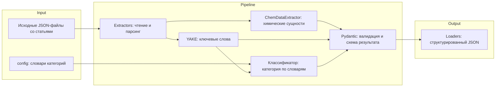

# Обработка и структурирование научных публикаций в области материаловедения

[](https://www.python.org/downloads/)
[](https://github.com/armatveeeva/scientific-articles-processor/actions)
[](LICENSE)
[](https://chemdataextractor.org/)
[](https://github.com/LIAAD/yake)

Репозиторий содержит программную реализацию пайплайна автоматизированного извлечения химических сущностей, генерации ключевых слов и структурирования метаданных из массива научных публикаций.

## Описание предмеа тной области

Современные научные базы данных содержат огромные массивы неструктурированного текста. Данный пайплайн решает задачу преобразования сырых текстов научных статей в структурированный машиночитаемый формат.

Система реализует следующие ключевые функции:
- Автоматическое распознавание химических элементов, соединений и материалов с использованием специализированной библиотеки `ChemDataExtractor`.
- Извлечение наиболее релевантных терминов из полного текста статьи с применением статистического алгоритма `YAKE` (Yet Another Keyword Extractor), не требующего предварительного обучения модели.
- Классификация статей по заданным тематическим категориям (например, металлы, композитные материалы, нанотехнологии) на основе совпадения с эталонными словарями.
- Формирование единого стандартизированного JSON-формата для последующего импорта в базы данных или проведения аналитических исследований.

## Технологический стек

- **Язык программирования:** Python 3.11+
- **Извлечение химических сущностей:** `chemdataextractor>=2.0`
- **Генерация ключевых слов:** `yake>=0.4.8`
- **Обработка данных:** `json`, `re` (стандартные библиотеки Python)
- **Хранилище данных:** Локальные структурированные JSON-файлы

## Архитектура

Пайплайн обработки данных разделен на модульные слои для обеспечения тестируемости и поддерживаемости:



## Быстрый старт

```bash
git clone https://github.com/armatveeeva/scientific-articles-processor.git
cd scientific-articles-processor
poetry install
poetry run <ВАША_КОМАНДА_ЗАПУСКА> --input <путь/к/входным/JSON> --output <путь/к/результату>
```

### Через Docker

```bash
docker build -t scientific-articles-processor .
docker run --rm -v "$(pwd)/data:/app/data" scientific-articles-processor <ВАША_КОМАНДА>
```

### Проверка кода и тесты

```bash
poetry run ruff check . && poetry run ruff format --check .
poetry run pytest
```
